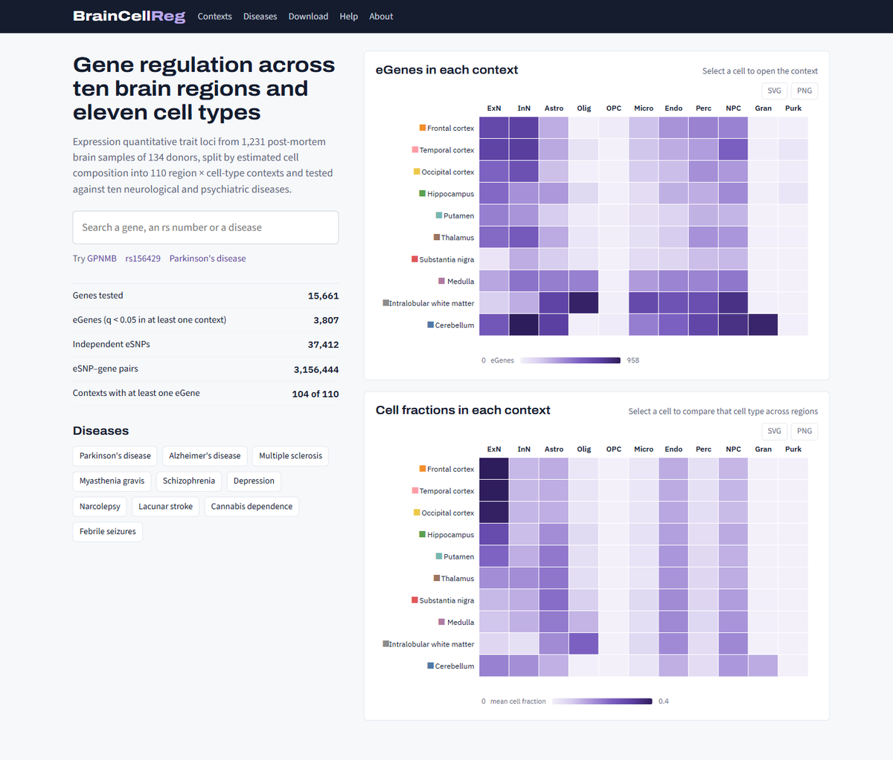
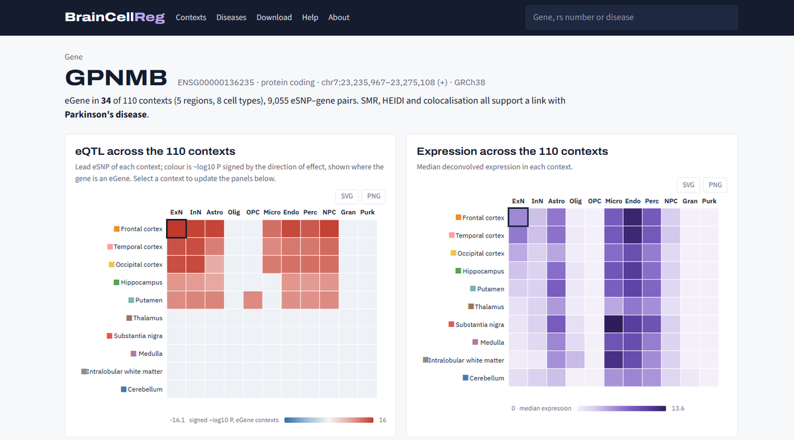
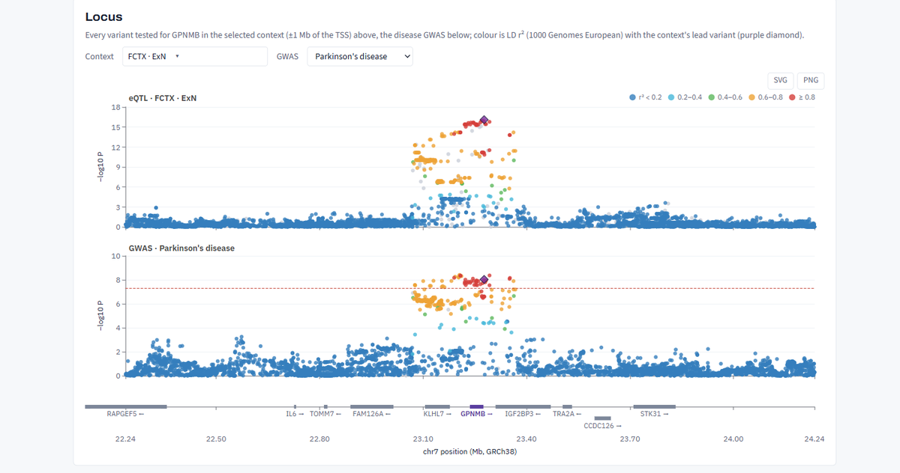
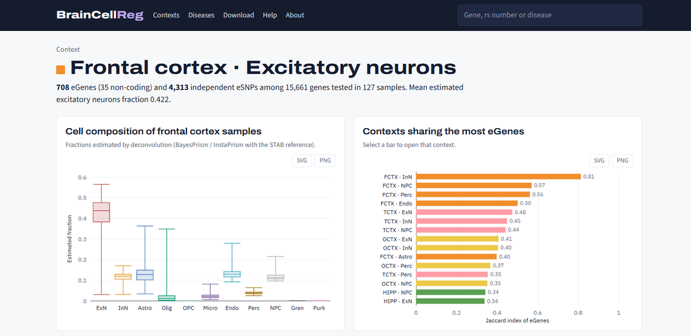
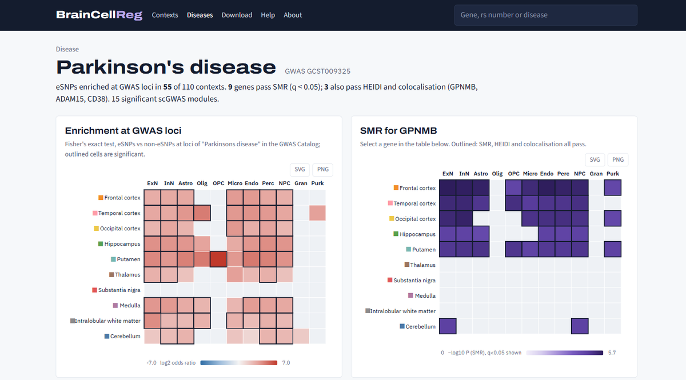

# BrainCellReg

**[braincellreg.com](https://braincellreg.com)** · a database of genetic regulation of gene expression across ten human brain regions and 110 region–cell type contexts.

BrainCellReg accompanies the manuscript *Mapping brain eQTLs across ten regions and cellular contexts nominates genes for neuropsychiatric disorders* (in preparation). This repository holds the code of the website and the analysis code of the study.

## What you can look up

<table>
  <tr>
    <td width="50%"> <b>A gene</b>: its eQTLs and deconvolved expression in all 110 contexts</td>
    <td width="50%"> <b>Its locus</b>: eQTL and disease GWAS signals coloured by LD with the lead variant</td>
  </tr>
  <tr>
    <td width="50%"> <b>A context</b>: cell composition, the contexts sharing the most eGenes, and every eGene</td>
    <td width="50%"> <b>A disease</b>: GWAS enrichment by context and genes supported by SMR, HEIDI, colocalization and scGWAS</td>
  </tr>
</table>

Variants (rs numbers) can be searched as well, and all tables can be downloaded from the site.

## Data in the database

Expression and genotype data of 1,231 postmortem samples from ten brain regions of 134 donors of the UK Brain Expression Consortium (UKBEC) were deconvolved with the STAB single-cell atlas into 110 region–cell type contexts, and cis-eQTLs were mapped in each context. For the 110 contexts, BrainCellReg provides:

- cell-type proportions and deconvolved expression;
- permutation and nominal cis-eQTL results, eGenes and independent eSNPs;
- genotype–expression plots;
- enrichment of disease risk variants among eSNPs, and SMR, HEIDI, colocalization and scGWAS results for ten neuropsychiatric disorders.

The ten regions are the frontal, temporal and occipital cortex, hippocampus, putamen, thalamus, substantia nigra, medulla, intralobular white matter and cerebellar cortex.

## Repository layout

| Folder | Content |
|---|---|
| `website/` | The BrainCellReg web application |
| `upstream/` | `upstream_pipeline_code.txt`: single-cell reference quality control, deconvolution with BayesPrism / InstaPrism, expression structure and CellChat analysis. `eqtl_mapping/`: expression BED files, PEER covariates and cis-eQTL mapping with tensorQTL in each region |
| `analysis/` | eGene and eSNP sets, eSNP annotation (ANNOVAR / FAVOR, Enformer, ENCODE histone marks, DNase peaks and cCREs, ReMap), expression structure of the deconvolved profiles (clustering, UMAP, CellChat), sharing between contexts, replication in single-nucleus and GTEx eQTL data, disease enrichment (Fisher's exact test), GWAS formatting, SMR and HEIDI, colocalization, scGWAS, external SMR replication, GO enrichment and the database tables |
| `supplementary/` | Scripts that write Supplementary Data 1–5 (Excel) from the result tables |
| `docs/img/` | Screenshots used in this README |

Scripts ending in `.slurm` are the job files used on our Slurm cluster. Paths in the scripts point to our cluster and need to be changed before reuse.

## Main software

R 4.5.0, Python 3, BayesPrism (InstaPrism), tensorQTL, PLINK 1.9, SMR 1.3.1, coloc 5.2.3, MAGMA 1.10, scGWAS, CellChat, limma, Seurat 4.3.0 and clusterProfiler 4.16.0.

## Data sources

UKBEC expression data are available from GEO (GSE60862). The STAB atlas, the GWAS Catalog, the GWAS summary statistics of the ten disorders, single-nucleus eQTL data (Bryois et al. 2022), ENCODE, ReMap 2022, and GTEx v8 and BrainMeta v2 eQTL data are available from their original sources. All results of the study can be queried and downloaded at https://braincellreg.com.

## Contact

BFGB group, Chongqing Medical University.
